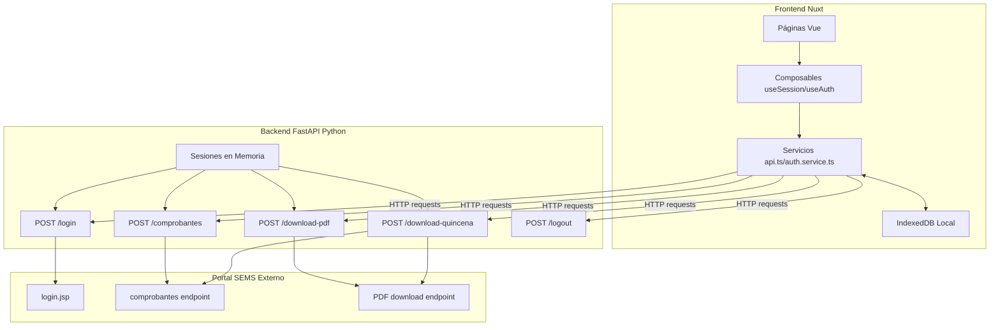
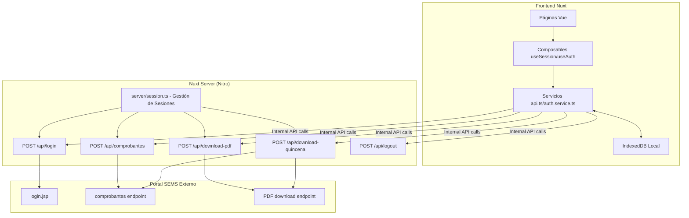
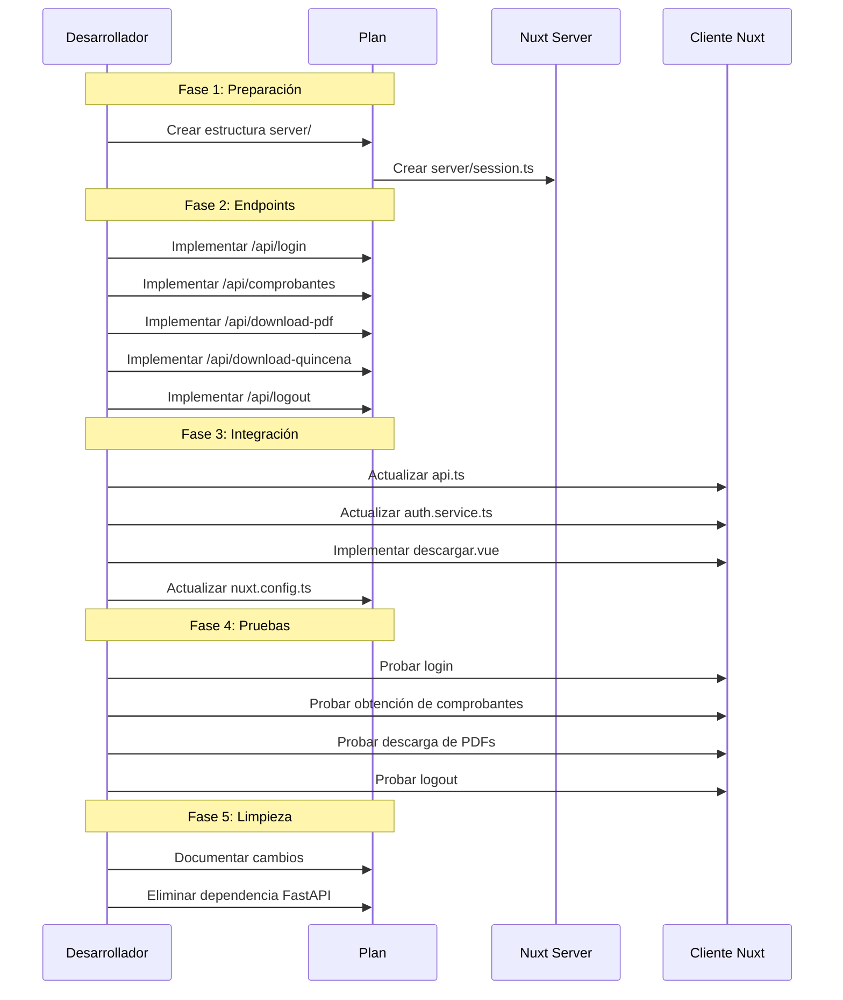

# Plan de Migración: FastAPI → Nuxt Server-Side

## Resumen Ejecutivo

Este documento detalla el plan para migrar los endpoints del backend FastAPI a Nuxt server-side (Nitro), eliminando la dependencia del backend Python y simplificando la arquitectura del proyecto.

## Arquitectura Actual



## Arquitectura Propuesta



## Endpoints a Migrar

### 1. POST /api/login
**Propósito**: Autenticar usuario contra el portal SEMS y crear sesión

**Request Body**:
```typescript
{
  rfc: string
  password: string
}
```

**Response**:
```typescript
{
  success: boolean
  message: string
  session_token?: string
}
```

**Lógica**:
1. Realizar GET a `https://portalautoservicios-sems.sep.gob.mx/login.jsp`
2. Realizar POST a `/j_spring_security_check` con credenciales
3. Validar autenticación exitosa (redirección)
4. Generar session_token único
5. Almacenar sesión con cookies en memoria
6. Retornar session_token al cliente

### 2. POST /api/comprobantes
**Propósito**: Obtener lista de comprobantes para año y quincena

**Request Body**:
```typescript
{
  session_token: string
  anio: number
  quincena: number
}
```

**Response**:
```typescript
Comprobante[] {
  idArchivo: number
  nombre: string
  plaza: string
  folioRecibo: string
  fechaInicialPago: string
  fechaFinalPago: string
  quincena: number
  anio: number
  totalPercepciones: number
  totalDeducciones: number
  totalNeto: number
  conceptos: Concepto[]
}
```

**Lógica**:
1. Validar session_token y recuperar sesión
2. Obtener RFC de la sesión
3. Construir URL con parámetros
4. Realizar GET a `/mvc/comprobantes/pago/` con headers específicos
5. Retornar JSON de comprobantes

### 3. POST /api/download-pdf
**Propósito**: Descargar un PDF de comprobante específico

**Request Body**:
```typescript
{
  session_token: string
  id_archivo: number
  qna_proc: string  // formato "20241"
}
```

**Response**: PDF binary data (application/pdf)

**Lógica**:
1. Validar session_token y recuperar sesión
2. Realizar GET a `/mvc/comprobantes/pago/descargar/pdf`
3. Retornar PDF con headers apropiados

### 4. POST /api/download-quincena
**Propósito**: Descargar todos los PDFs de una quincena

**Request Body**:
```typescript
{
  session_token: string
  anio: number
  quincena: number
}
```

**Response**:
```typescript
{
  comprobante: Comprobante
  pdf_base64: string
}[]
```

**Lógica**:
1. Obtener lista de comprobantes
2. Para cada comprobante, descargar PDF
3. Codificar PDF en base64
4. Retornar array con comprobantes y PDFs

### 5. POST /api/logout
**Propósito**: Cerrar sesión del usuario

**Request Body**:
```typescript
{
  session_token: string
}
```

**Response**:
```typescript
{
  success: boolean
  message: string
}
```

**Lógica**:
1. Eliminar sesión de memoria
2. Retornar confirmación

## Gestión de Sesiones en el Servidor

### Estructura de Sesión
```typescript
interface ServerSession {
  sessionToken: string
  rfc: string
  cookies: string[]  // Array de cookies para mantener sesión con SEMS
  createdAt: number
  lastUsed: number
}
```

### Implementación (server/session.ts)
- Usar `Map<string, ServerSession>` para almacenamiento en memoria
- Para producción, considerar Redis o similar
- Implementar limpieza de sesiones expiradas
- Proporcionar métodos: `createSession`, `getSession`, `deleteSession`, `cleanupExpired`

## Cambios en Configuración

### nuxt.config.ts
- Remover configuración de `public.apiUrl` (ya no necesaria)
- Asegurar que `nitro` está configurado correctamente (por defecto en Nuxt 3/4)
- Configurar `serverMiddleware` si es necesario

### Variables de Entorno
- Remover `NUXT_PUBLIC_API_URL` (ya no necesaria)
- Mantener variables existentes para otras configuraciones

## Cambios en Servicios del Cliente

### api.ts
- Cambiar `getApiBaseUrl()` para retornar string vacío o `/api`
- Actualizar todos los endpoints para usar rutas relativas (`/api/login`, etc.)
- Implementar métodos faltantes: `getComprobantes`, `downloadPdf`, `downloadQuincena`

### auth.service.ts
- Actualizar `getBackendUrl()` para usar endpoints internos
- Mantener lógica de IndexedDB y cifrado (no cambia)

## Implementación de Descarga en Frontend

### descargar.vue
- Implementar lógica real de descarga usando el servicio `api.ts`
- Mostrar progreso de descarga
- Manejar errores apropiadamente
- Permitir descarga individual o masiva

## Flujo de Trabajo de Implementación



## Consideraciones Técnicas

### Cookies y Sesiones
- Nuxt server debe mantener cookies de SEMS para cada sesión
- Usar `set-cookie` headers de SEMS y almacenarlas
- Incluir cookies en requests subsecuentes a SEMS

### Manejo de Errores
- Implementar manejo robusto de errores en cada endpoint
- Retornar códigos HTTP apropiados (401 para sesión inválida, 500 para errores de servidor)
- Incluir mensajes descriptivos en español

### Seguridad
- Validar session_token en cada request protegido
- Implementar timeout de sesiones (ej. 30 minutos de inactividad)
- Considerar rate limiting para prevenir abuso
- Mantener cifrado de credenciales en IndexedDB (no cambia)

### Performance
- Usar `undici` para requests HTTP de alto performance
- Implementar caching apropiado si es necesario
- Considerar streaming para descargas de PDFs grandes

## Testing

### Casos de Prueba
1. **Login Exitoso**: Credenciales válidas → sesión creada
2. **Login Fallido**: Credenciales inválidas → error apropiado
3. **Obtener Comprobantes**: Sesión válida → lista de comprobantes
4. **Obtener Comprobantes - Sesión Inválida**: Error 401
5. **Descargar PDF**: Sesión válida → PDF descargado
6. **Descargar Quincena**: Sesión válida → array con PDFs base64
7. **Logout**: Sesión eliminada correctamente

### Pruebas de Integración
- Flujo completo: login → obtener comprobantes → descargar PDFs → logout
- Múltiples sesiones concurrentes
- Sesiones expiradas

## Beneficios de la Migración

1. **Simplificación**: Eliminar backend Python reduce complejidad
2. **Single Stack**: Todo en TypeScript/JavaScript
3. **Menos Infraestructura**: Solo un servidor Nuxt en lugar de dos
4. **Mejor Performance**: Comunicación interna más rápida que HTTP
5. **Mantenimiento**: Menos código y tecnologías que mantener
6. **Deployment**: Más simple (solo Nuxt)
7. **Costos**: Menos recursos de servidor

## Riesgos y Mitigaciones

| Riesgo | Mitigación |
|--------|------------|
| Gestión de sesiones en memoria puede perderse en restart | Implementar Redis para producción |
| Cambios en el portal SEMS pueden romper la integración | Mantener tests y monitoreo activo |
| Performance de descargas masivas | Implementar streaming y async processing |
| Manejo de cookies puede ser complejo | Usar librerías probadas como `cookie` |

## Pasos Siguientes

1. Revisar y aprobar este plan
2. Iniciar implementación fase por fase
3. Realizar pruebas exhaustivas
4. Documentar cualquier cambio necesario
5. Eliminar dependencia de FastAPI después de validación completa
